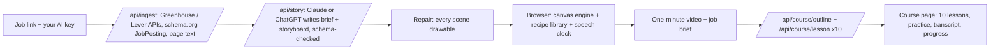

# Career Ready

**Paste a job link and your own AI key. In about a minute, watch a narrated, animated one-minute story
of the job, read a job brief, and (if you want) build a full 10-lesson course with practice questions.**

**Live:** https://career-ready-sand.vercel.app · **No key? Watch the sample:** https://career-ready-sand.vercel.app/job/sample

Built at **BAU Innovate 2026** (Nov 19). Track: Education & Student Experience.

## Why

Students apply to organizations they don't understand. Generic interview prep doesn't explain *this*
employer and *this* role. Career Ready teaches the organization first, then the work, then what the
employer is really hiring for, in the format people actually finish: a short animated story.

## How it works



- **Storyboards, not videos.** The AI never draws. It picks one of nine *recipes* per scene (opener,
  organization map, value flow, record card, people, comparison, steps, statement, question) and fills in
  its data. Structured outputs (zod schema) force the shape; `src/lib/validate.ts` repairs what a schema
  can't.
- **Live animation.** `src/engine/` is our open-source Continuous-Learning-Video canvas engine, ported
  to run in the browser. `src/engine/recipes.cjs` (written today) turns each scene into choreography
  timed to the narration: cue-timed reveals, a yellow highlighter on the word being spoken, camera
  pans, iris and wipe transitions, an illustrated cast, a fiction badge.
- **Speech clock.** Scene spans are estimated from word counts; the player speaks each scene with the
  browser's voice and holds (or catches up) so picture and voice stay together. Best in Microsoft Edge
  (Microsoft natural voices).
- **Bring your own key.** The key travels in a request header to Anthropic or OpenAI for that request
  only. It is never stored or logged. Jobs and progress live in the browser's localStorage.
- **Honest by design.** Posting facts vs. general knowledge (tagged "verify") vs. fictional teaching
  examples (violet badge). No invented company facts, no hiring scores.

The full method (teaching approach, research rules, visual language, scene recipes, timing, page
spec, quality review) is in [`docs/methodology/`](docs/methodology/), and the prompts the app sends are
built from those files by `scripts/build-prompts.mjs`.

## Roadmap

Jobs are the first use. The engine underneath is general: **the AI writes a storyboard, our engine draws it**, so the same pipeline can explain anything.

| Stage | What it adds |
|---|---|
| **Today** | Any job link → a narrated one-minute video, a job brief, and a 10-lesson course with practice questions |
| **Next: choose a template** | Pick the look that suits you (for example Editorial, Chalkboard or Bright). Same story, same method, a different visual style |
| **Then: beyond jobs** | Paste a topic, an article or class materials and get a narrated video and lessons. **Students** turn their class notes into study videos; **teachers** turn lecture slides into lessons with practice |
| **For institutions** | One institutional key for a career-services or class pilot, licensed voices (Azure AI Speech), cited research beyond the source, and MP4 export with captions |

The method stays the same at every stage: the big picture first, then the details, then the learner in it, with every claim labelled by source.

## Run it

```bash
npm install
npm run dev        # http://localhost:3000
```

Paste a job link and your Claude (`sk-ant-…`) or OpenAI key in the page. No server keys are needed.
`/job/sample` plays a built-in sample without any key. Deployed on Vercel from this repository; every push to `main` redeploys.

## Built on pre-existing work (cited)

**See [BUILD-LOG.md](BUILD-LOG.md)** for the commit timeline and a file-by-file list of what was reused and what was written during the hackathon.

Organizers confirmed that open source, earlier projects and other sources may be used if cited.

- **Reused:** the Continuous-Learning-Video animation engine (Apache-2.0, LICENSE and NOTICE in
  `src/engine/`), engine parts and the course-page design from our earlier Axios AI Fellow course
  edition, and our course-design method. Fonts are OFL.
- **Built during the hackathon:** this web platform: job ingest, the bring-your-own-key AI layer and
  prompts, schemas and repair, the browser port of the engine, the recipe library, the speech-clock
  player, the job page, the course page and generation flow.
- Full list with licenses: [CREDITS.md](CREDITS.md).

## AI tools used

Claude Code (Anthropic) for AI-assisted coding, reviewed by the team. Inside the product: the Claude API
(Opus 5.5 default; Sonnet 5.5 and Haiku 5.5 selectable) or the OpenAI API, with the user's own key.
