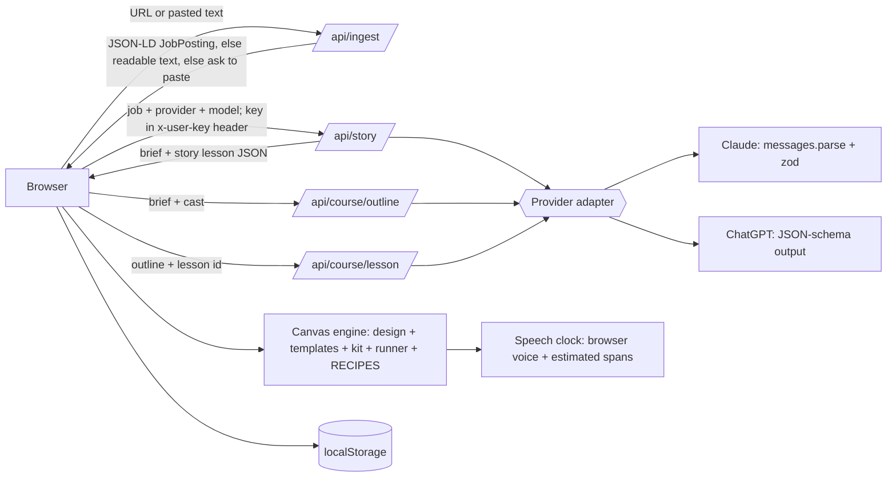

# Career Ready: architecture (v2, built on your existing engine)

> Copy into the repo as `docs/ARCHITECTURE.md` (milestone M0 does this). Claude Code reads it
> before every step.

## 1. The product (nothing more)

1. **Landing page.** Paste a job URL, choose Claude or ChatGPT, paste your key, press **Make my video**.
2. **First video, about 1 minute.** A narrated, animated story of the organization and the role, in the house style of your courses. A short **job brief** sits under it.
3. **Full course (optional).** One button builds a **10-lesson course page**: the same newsroom-style page as your Axios courses, with lesson navigation, narrated animated lessons, transcript and practice questions with feedback.

There are no accounts and no database. Everything generated is kept in the browser.

## 2. What we reuse vs. build today

The highest-quality work so far is the two Axios editions in `~/Desktop/COffix/`:

- **Axios AI Fellow** (Nov 9, the latest): white editorial "newsroom graphics" look, data-led
- **Axios Salesforce BA** (Oct 21): illustrated case with record cards and a recurring cast

Both run on the same engine. **Their drawing code is plain Canvas 2D**, so it can run live in a
browser `<canvas>` instead of being rendered to MP4. That gives Career Ready exactly the same
look with no rendering wait.

| Piece | Source (pre-existing) | Reuse how |
|---|---|---|
| Design system: tokens, type roles, stage, audit, camera, word timing | `axios-ai-fellow/production-source/design.cjs` (themed "Axios edition 2" tokens); core is open source in `TahaDali/Continuous-Learning-Video`, Apache-2.0 | Copy and port to the browser (M1) |
| Templates: opener, statement, compare, stepper, question, progress rail, fiction badge | `…/templates.cjs` | Copy as-is |
| Cast figures: faces, hair, clothes, poses, talking mouths | `…/illustrations.cjs` | Copy as-is |
| Kit + glyphs: doc, folder, card, building, clock, gate, magnifier, lock, person, campus, hall, pin, ballot, bubble, megaphone, envelope, calendar, table, sheet, form, coin, idCard, and the AI glyphs | `…/kit.cjs`, `…/glyphs.cjs`, `…/ai.cjs` | Copy as-is |
| Lesson runner: scene regions, camera pans, iris/wipe/carry transitions, night practice ground, rail, badge | `…/runner.cjs` | Copy; replace its `require('./course.cjs')` with our own setup |
| Fonts: Inter, Instrument Serif, JetBrains Mono (OFL) | `…/fonts/` | Serve from `/public/fonts` |
| Course page: masthead, lesson list, course contents, practice with per-option feedback, progress | `axios-ai-fellow/player/{index.html,style.css,player.js}` | Port into a React page; swap `<video>` for the live canvas player (M5) |
| Teaching method: organization first, causal story, honest labels, transfer questions | the `continuous-learning-video` skill | Condensed into `app-prompts/*.md` |

**Built today** (this is the hackathon project):

- the browser port of the engine runtime
- the **generic scene recipe library**, so AI-written JSON drives the engine
- the speech clock
- ingest, the bring-your-own-key AI layer and the prompts
- the landing page, the course-generation flow and the integration

**Rule check:** the rules allow "public frameworks, libraries, and templates (respect licenses)"
but say "pre-existing projects may not be presented as entirely new work". So:

- disclose the engine reuse everywhere (submission, README, pitch)
- **ask an organizer at 9:30** whether reusing your own open-source engine is fine
- `kit.cjs`, `glyphs.cjs`, `ai.cjs` and `runner.cjs` are **not** in the public repo yet. If you want them to count as a "public library", push them there before 10:00 (your call)
- If the organizer says no, use **Plan B** (section 9)

## 3. System diagram



The key travels in a header, is used for one request, and is **never logged or stored**
server-side. The client keeps it in `sessionStorage`, or `localStorage` if the user ticks
"remember".

## 4. Data: the same shape as your `course.json`

The story video is simply **lesson "00"**. Course lessons are "01"–"10". All of them use the
existing lesson fields (`id, title, part, goal, scenes[], question, options, answer,
explanation, optionFeedback`), plus a `recipe` + `data` on each scene that tells the engine
what to draw.

```ts
interface JobInput { url?: string; text: string; title?: string; company?: string; source: "jsonld"|"html"|"pasted" }

type Basis = "posting" | "general-knowledge";          // general-knowledge → shown with "verify"

interface JobBrief {
  employer: string; title: string; location?: string; seniority?: string;
  oneLiner: string;
  orgContext: { text: string; basis: Basis }[];                 // 2–4
  responsibilities: { id: string; text: string }[];            // R1… ≤ 6
  required: { id: string; text: string }[];                    // Q1…
  preferred: { id: string; text: string }[];                   // P1…
  keywords: string[];                                          // ≤ 10
  interviewQuestions: { question: string; strongAnswerHas: string[] }[]; // 3
  unknowns: string[];
}

// Cast looks MUST use the engine's enums (illustrations.cjs exports LOOK_FIELDS, HAIR_STYLES, TOPS, POSES).
interface CastMember { key: string; name: string|null; role: string|null;
  skin: string; hair: string; style: string; top: string; topColor: string; inner?: string; bottom: string; glasses?: boolean }

interface Scene {
  id: string;            // unique within the lesson, kebab-case
  headline: string;      // ≤ 6 words, shown in the section head
  narration: string;     // spoken; word budget per recipe (section 5)
  fiction: boolean;      // fiction badge on/off
  recipe: Recipe;        // section 5
  data: RecipeData;      // shape depends on recipe
}

interface Lesson {
  id: string; title: string; part: string; goal: string;
  scenes: Scene[];
  question: string; options: string[]; answer: number; explanation: string; optionFeedback: string[];
  extraQuestions?: { question: string; options: string[]; answer: number; explanation: string; optionFeedback: string[] }[]; // 0–2 more
  keyTerms: { term: string; definition: string }[];
}

interface StoryResult { brief: JobBrief; cast: CastMember[]; story: Lesson }  // story.id = "00", 6–7 scenes
interface CourseOutline { title: string; tagline: string; lessons: { id: string; part: string; title: string; goal: string; requirementIds: string[] }[]; exclusions: { requirementId: string; reason: string }[] }
```

Keeping the `course.json` shape means a Career Ready course can later be handed to the MP4
pipeline unchanged. That's the roadmap story.

## 5. The recipe library: what the AI can ask the engine to draw

Each recipe is a `draw(S, t, X)` scene for `runner.lessonWorld`. It's built from the existing
templates, kit and glyphs, and **written today**. The AI only chooses a recipe and fills in its
`data`. It never writes drawing code.

| recipe | data | Built from | Min. narration words |
|---|---|---|---|
| `opener` | `{ kicker, title, highlight, glyph }` | AI Fellow lesson-opener layout: hero glyph left, title right, italic serif subtitle with yellow highlight | 12 |
| `statement` | `{ text, emphasis }` | `templates.statement` (one claim, one highlighted word) | 9 |
| `org` | `{ center: {label, glyph}, around: [{label, relation, glyph\|castKey}] (3–5) }` | `kit.building`/`glyphs.campus` + people/glyphs on an arc, connectors drawn on cue | 16 |
| `flow` | `{ steps: [{label, glyph}] (3–5), active, token }` | progress-rail steps (like "01 FIND · 02 SELL · 03 DELIVER · 04 BILL") + glyph cards + an arrow chain; the active step highlighted | 16 |
| `record` | `{ header, title, rows: [{field, value}] (2–4), state }` | the Salesforce-BA record card: black header band, rows fill on cue, state stamp | 14 |
| `cast` | `{ people: castKey[] (1–3), line: {who, text}, prop?: glyph }` | `illustrations.cast` figures, a talking mouth, a speech bubble | 12 |
| `compare` | `{ title, left: {title, rows[]}, right: {title, rows[]}, takeaway }` | `templates.compare` | 16 |
| `stepper` | `{ title, steps: string[] (3–5) }` | `templates.stepper` | 14 |
| `question` | `{ prompt, options (3–4), correct, reason }` | `templates.question` on the night ground | 14 (+3 s answer hold) |

`glyph` is an enum of kit/glyph names: `doc, folder, card, building, campus, hall, clock,
calendar, gate, magnifier, lock, envelope, megaphone, bubble, pin, ballot, table, sheet, form,
coin, idCard, person, phonePost, poster`.

Engine safety rules (the templates **throw** on bad input, so recipes must defend):

- Each template has a `MIN_SPAN` (opener 4.5 s, compare 6 s, stepper 5 s, question 6 s, statement 3 s). Validate the word budgets server-side; the player also stretches a scene's span to at least its minimum.
- `statement.emphasis` and every cue word must appear in the narration exactly. Use a **safe cue** helper: look the word up; if it's missing, spread the reveals evenly across the span. Never call a throwing cue with unchecked AI text.
- Labels ≤ 4 words, values ≤ 3 words. Truncate with "…" before drawing. The design stage enforces a 24-content-word-per-frame budget and type floors.
- Wrap every recipe's `draw` in try/catch. On error, draw a **fallback scene** (section head + one glyph + the headline) and log the error to the console. A live demo must never show a blank canvas.
- In the browser, the audit's checks only **warn** (console). They never throw.
- `defineCast`/`defineStates`/`defineParts` are define-once registries. Give the browser port a `resetRegistries()`, or reload the page when switching jobs.

Course-wide choices, made once in our `career-setup.js` (it replaces `course.cjs`):

- state code `posting` (cobalt, solid) / `fiction` (hatched slate) / `decided` (umber)
- parts I–VI
- the cast, defined from the AI's `CastMember[]` at load time

## 6. The clock: estimated spans + browser voice

The engine needs each scene's `start`/`end` before drawing (`wordTimes` estimates word
cues from the span; that's the existing `estimated` method).

1. **Before playing:** span = max(MIN_SPAN, words ÷ rate). Rate is 2.5 words/s × the speed setting, plus a 0.6 s pause. Lay scenes end to end, and the engine draws at time `t`.
2. **During playback:** a `requestAnimationFrame` loop advances `t`. When a scene starts, `speechSynthesis.speak()` its narration.
   - If `t` reaches the scene end while the voice is still speaking, **hold** `t` just before the end until `onend` fires.
   - If the voice finishes early, let `t` run on to the scene end.
   - Animation and voice stay in step to within a scene, with no measured timings needed.
3. **Captions** come from the estimated word times (the current sentence, current word underlined).
4. **Voice:** prefer **Microsoft Edge with "Microsoft Ava/Andrew Online (Natural)"**, the same Microsoft neural voices your courses used. In Chrome, prefer local "Samantha"/"Daniel". Avoid "Google …" voices (network voices that cut off after about 15 s). **Demo in Edge.**
5. **Muted or no voice:** the same clock runs silently, with captions on.

Controls: play/pause (Space), previous/next scene, speed 0.9/1/1.15, voice, captions (C),
and a scene list as the transcript.

## 7. Look and feel: "Axios edition 2" tokens (from the AI Fellow edition)

```
paper #FFFFFF · paperLo #F1F2F4 · ink #0D0F13 · inkSoft #3C424B · rule #D2D6DC
ink-blue (teal token) #22406E · cobalt #2350C8 / #4A64A8 · highlighter (signal) #FFD60A / soft #FFF0A0
wrong #E0242D (only wrong) · good #06855A (only correct) · fiction #6A3BEF (only the badge) · night #0F1B33
Inter (UI and labels) · Instrument Serif italic (quotes, subtitles) · JetBrains Mono (kickers, metadata, numbers)
```

Page grammar: a 6 px cobalt top border, mono uppercase kickers, square 2 px ink-bordered
buttons, a yellow focus ring, huge tight Inter headlines, black rules between sections.
Video grammar: a section rule + headline, a top rail of part steps, the purple fiction badge,
focus moved by dimming, and yellow only for "the thing being said now".

The landing page uses the same tokens: one headline, one input, one key field, one button.

## 8. Folder layout

```
career-ready/
├─ docs/ARCHITECTURE.md · docs/app-prompts/*.md
├─ public/fonts/*.ttf                       (copied, OFL)
├─ src/engine/                              (copied from axios-ai-fellow, then ported)
│  ├─ design.cjs templates.cjs illustrations.cjs motion.cjs finite-canvas.cjs
│  ├─ kit.cjs glyphs.cjs ai.cjs runner.cjs
│  ├─ browser-runtime.js                    NEW: fonts via FontFace, canvas factory, no `path`
│  ├─ career-setup.js                       NEW: replaces course.cjs (states, parts, cast from JSON)
│  ├─ recipes/*.js                          NEW: the 9 recipes + fallback
│  └─ world.js                              NEW: lesson JSON → runner.lessonWorld spec
├─ src/app/page.tsx                         landing
├─ src/app/job/[hash]/page.tsx              first video + brief
├─ src/app/job/[hash]/course/page.tsx       ported course page
├─ src/app/api/{ingest,story,course/outline,course/lesson}/route.ts
├─ src/components/{CanvasPlayer,SpeechClock,Captions,BriefCard,KeyInput,Practice}.tsx
├─ src/lib/{schemas,ingest,store,validate}.ts · src/lib/providers/{index,anthropic,openai}.ts
└─ public/samples/demo.json                 offline demo record (made at 5 PM)
```

## 9. Plan B (if the engine port fails by 11:30, or reuse isn't allowed)

Keep everything except `src/engine`. Claude Code builds a compact **Canvas 2D mini-engine from
the written specs**, with no repo code copied:

- [methodology/03-visual-language.md](methodology/03-visual-language.md): style, tokens, type, motion, cast and glyph anatomy
- [methodology/04-scene-recipes.md](methodology/04-scene-recipes.md): the 9 recipes
- [methodology/06-course-page-spec.md](methodology/06-course-page-spec.md): the pages

The data contract, prompts, clock and pages are unchanged. Paste-ready prompts and the revised
timings are in [methodology/08-plan-b-no-repo.md](methodology/08-plan-b-no-repo.md).

## 10. Models, cost, limits

| Call | Default model | Effort | Approx. cost (Opus 5.5) |
|---|---|---|---|
| Story + brief | `claude-opus-5-5` | `low` | ~$0.10 |
| Outline | `claude-opus-5-5` | `medium` | ~$0.08 |
| Each lesson | `claude-opus-5-5` | `medium` | ~$0.15 (10 ≈ $1.50) |

- **Dropdown:** Opus 5.5 (best) · Sonnet 5.5 `claude-sonnet-5-5` (faster) · Haiku 5.5 `claude-haiku-5-5` (cheapest). ChatGPT uses the current flagship, set in one constant. **Time the story call at M2.** If it's over 60 s, make Sonnet 5.5 the demo default.
- **Claude:** `client.messages.parse` + `output_config: { format: zodOutputFormat(schema), effort }`, `max_tokens` 16000. No `thinking`, `temperature` or prefill. Handle `stop_reason` `refusal`/`max_tokens`.
- **Structured-output schema limits:** if the API rejects constraints (array min/max, string lengths, unions), send a relaxed schema and enforce the full rules in `validate.ts`, with one repair retry.
- **Course build:** the outline first, then lessons with **concurrency 2** and a retry on 429 (new API keys have low output-tokens-per-minute limits). A full course takes about 3–6 minutes, and lesson 01 is playable after about 1 minute.
- **Vercel:** set `export const maxDuration = 120` on AI routes. If the plan caps lower, use Sonnet 5.5 for lessons.
